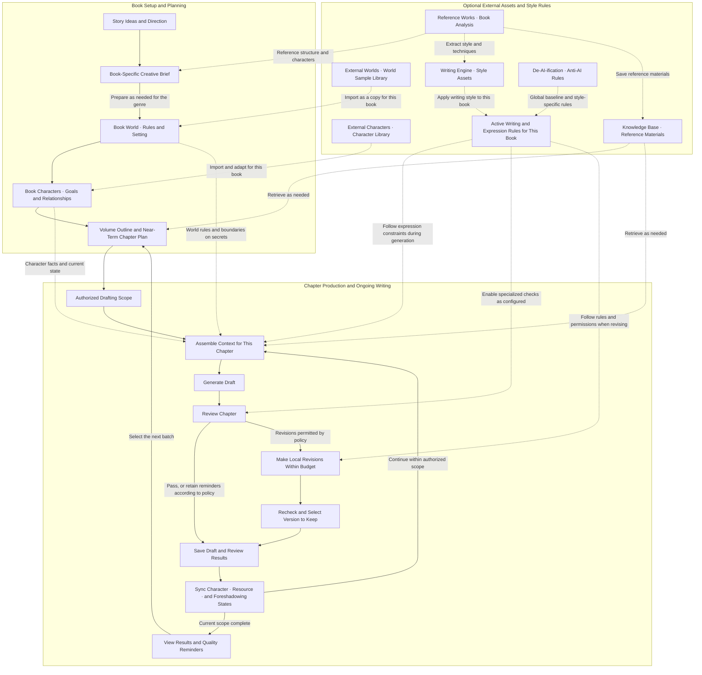

<p align="center">
  
</p>

<h1 align="center">AI Novel Writing Studio</h1>
<p align="center"><strong>Biz Novel Studio · From a spark of inspiration to a complete novel</strong></p>
<p align="center">AI helps you plan your world and characters, write chapter by chapter, review your work, and save it—giving long-form writing a path forward.</p>
<p align="center"><sub>Open-source AI novel writing assistant and long-form production studio.</sub></p>

<p align="center">
  <a href="https://biznovelstudio.com"><strong>🌐 Official Website | User Guide, Downloads, and Release Notes</strong></a>
</p>

<p align="center">
  <a href="https://github.com/ExplosiveCoderflome/AI-Novel-Writing-Assistant/releases/latest"></a>
  <a href="./LICENSE"></a>
  <a href="https://linux.do/"></a>
  <a href="./package.json"></a>
</p>

<p align="center">
  
  
  
  
</p>

<p align="center">
  
  
  
  
</p>

<p align="center">
  <a href="https://trendshift.io/repositories/26664"></a>
</p>

<p align="center">
  <a href="https://github.com/ExplosiveCoderflome/AI-Novel-Writing-Assistant/releases/latest"><strong>Download the Windows desktop app</strong></a> ·
  <a href="https://biznovelstudio.com">Official website and documentation</a> ·
  <a href="#quick-start">First-time use</a> ·
  <a href="#源码运行">Run from source</a> ·
  <a href="https://github.com/ExplosiveCoderflome/AI-Novel-Writing-Assistant/issues">Report an issue</a>
</p>

---

You only need an idea to get started. This workbench helps you connect the direction, characters, world, and chapters, while keeping your manuscript, settings, and progress organized as you write. Long-form projects are advanced continuously by the Auto Director, while short stories follow a separate end-to-end drafting workflow. It’s designed for first-time novelists, and also offers more detailed tools for authors and developers who need to maintain long-term project materials or explore AI-assisted writing workflows.

**The desktop version is ready for writing; the source-code version is for development and self-hosting.** You’ll need to configure your own API credentials for models. Knowledge-base retrieval can be enabled as needed.

[Latest Updates](#latest-updates) · [What It Can Do](#what-it-can-do-now) · [Director Versions and Modes](#director-versions-and-modes) · [Feature Preview](#feature-preview) · [Documentation](#documentation) · [Get Involved](#get-involved)

## Latest Updates

### 2026-11-16 · v0.8.7

Desktop version `v0.8.7`: When an “Interactive Refinement” proposal for an outline contains an invalid dependency, omits the volume for a new chapter, or mistakenly changes a volume’s chapter list, the app now displays a clear message in Chinese and rejects the proposal instead of showing a generic server error. A failed application no longer leaves behind a partial result.

#### Fixes

- Outline “Interactive Refinement” proposals: If a dependency is mistakenly entered as a node ID, a new chapter has no volume specified, or a volume’s chapter list is mistakenly changed, the app displays a clear message in Chinese and rejects the proposal instead of showing a generic server error. A failed application no longer leaves behind a partial result.

[View the full release history](docs/releases/release-notes.md)

For the official desktop release, use the five-platform **v0.8.7** installers on GitHub Releases. `v0.8.6` was the previous complete five-platform release, and `v0.8.5` also included all five platforms. `v0.8.4` has no Windows package; the `v0.8.3` tag was pushed but packaging failed, so there are no installers; and the `v0.8.2` annotated tag does not correspond to a downloadable release. For features and acknowledgments, see the [full release history](docs/releases/release-notes.md).


## What It Can Do Now

| What you want to do | How the workbench helps | Learn more |
| --- | --- | --- |
| Turn an idea into a book concept | The Auto Director organizes the genre, selling points, character goals, and possible directions. You can also start with a popular genre or a completed book analysis. | [Novels and getting started](./docs/public/modules/novels.md) |
| Write a complete short story | Start by choosing an idea and direction, then create a 3,000–30,000-word short story that you can read through, revise, and export. You can also start a separate long-form project to expand the original story. | [Short-story workflow](#write-a-complete-short-story) |
| Keep writing subsequent chapters | V2 works within your authorized scope to advance near-term planning, chapter tasks, scenes, prose, checks, and saving. V1 retains the original workflow. | [Versions and modes](#director-versions-and-modes) |
| Maintain the world and characters of a book | Save the book’s world, characters, relationships, and chapter status. Explore the world map and character relationship diagram to support future writing. | [World Sample Library](./docs/public/modules/world-sample-library.md) · [Character Library](./docs/public/modules/character-library.md) |
| Control how your work is written | Style assets and anti-AI rules inform drafting, checks, and targeted revisions. Detection and automatic correction take effect according to each book’s settings. | [Style Engine](./docs/public/modules/style-engine.md) · [Anti-AI Rules](./docs/public/modules/anti-ai-rules.md) |
| Study reference works and reuse materials | Analyze a book’s structure, characters, and writing style, with links back to supporting passages in the source text. Results can be used in the knowledge base, as style assets, or as a reference when starting a book. | [Book Analysis Workspace](./docs/public/modules/book-analysis.md) |
| Use long-term materials while writing | Knowledge-base and RAG retrieval bring up relevant materials, which are combined with the book’s world, characters, and style to assemble chapter context. | [Knowledge Base](./docs/public/modules/knowledge-base.md) |
| See what the AI is doing and how much it uses | AI Live shows the execution process and reconnects after disconnection. The V2 novel usage page shows recorded call usage, while Run Records show progress and sources. | [Run Records](./docs/public/modules/task-center.md) · [Usage details](#understanding-ai-usage) |
| Reduce repeated costs during ongoing writing | Organize stable reference materials separately from changing plot details, retain reusable input prefixes, and reduce repeated reviews under the same conditions. | [Token caching and call optimization](#token-caching-and-call-optimization) |
| Choose the right model for each task | Configure providers, test connections, and set model routing in the app. Choose separate models for planning, drafting, review, and book analysis. | [Model Settings](./docs/public/modules/system-settings.md) · [Model Routing](./docs/public/modules/model-routing.md) |
| Adapt a novel into other materials | Turn existing chapters, characters, and scenes into comic storyboards, character visual assets, and short-form drama materials. | [Comics](./docs/public/modules/comic-workspace.md) · [Short-form Drama](./docs/public/modules/short-drama-workspace.md) |

Creative Hub also offers conversational creative guidance, planning, and tool use to help you decide what to do next. Comics and short-form drama are best used once the novel’s main storyline, characters, and chapter content are established. [Learn about Creative Hub](./docs/public/modules/creative-hub.md)

## Director Versions and Modes

**For long-form writing, choose a Director version first, then decide how to proceed this time. V2 does not mean fully automatic, and V1 does not mean manual.** Short stories use a separate workflow and do not require a Director version.

### Choosing between V1 and V2

| | Director V1 | Director V2 |
| --- | --- | --- |
| Where to start | The original Director and Novel Workspace, with its familiar phased writing workflow | The Book Director workspace, where you can review the outline, manuscript, and reference materials in one place and continue writing |
| Best for | Continuing an existing novel or keeping the original workspace workflow | Starting a new book and planning and generating continuously within an authorized scope |
| Tasks and recovery | Uses its own tasks, checkpoints, and recovery workflow | Uses its own runs, phase results, and saved progress |
| Version selection | Existing novels retain their assigned version | When V2 is available, new books default to V2 |

On the book creation page, you can choose an available Director version. To switch an existing novel, first finish the current writing run, then change the version in the book settings. Saved text and historical records will be retained. **Switching versions only saves your selection; it does not start generation or resume old tasks from the other version.**

The desktop version and source-code deployment offer both V1 and V2 by default. To temporarily disable V2, explicitly set `DIRECTOR_NEXT_ENABLED=false`. This setting only controls whether V2 is available; it does not change the Director assigned to existing novels.

### V2: Fully Automatic or Confirm Each Phase

| Writing mode | How the AI proceeds | What you need to do |
| --- | --- | --- |
| **Fully automatic** | Within the scope you authorize, it fills in any required planning, drafts, checks, and saves. It proceeds automatically through ordinary phases. | Choose a direction and scope first. If a specific issue requires a pause, address it, then continue from the Book Director workspace. |
| **Confirm each phase (semi-automatic)** | At phases that require confirmation, it saves the result and waits for you to review it before proceeding. Drafting requires confirmation at the end of each batch. | Open the phase result, review it, and click Confirm. You don’t need to manually trigger the entire workflow chapter by chapter. |

The current mode appears next to the book title and at the top of the Director workspace. Subsequent drafting batches use the selected mode. In V2, phase confirmations happen in the Book Director workspace. Run Records let you check status and open the source page; continue, resume, and cancel actions are handled in the source workspace.

### Why Fully Automatic Runs Can Still Pause

Fully automatic mode continues within the scope you authorized. **When that scope is complete, you’ll need to choose the next section.** For example, if you submit chapters 1–3, it will not start writing chapter 4 on its own.

The system may also pause if a model is unavailable, replanning is needed, usage protection is triggered, or there is a data integrity issue. By default, ordinary localized quality issues are recorded as chapter reminders and the run continues. If you explicitly choose a “quality first” handling strategy, the run may wait for manual review after the text is saved.

The default per-chapter limit in V2 is **100,000 tokens**, including calls for that chapter’s generation, checks, revisions, and reference-material preparation. For new chapters, usage is calculated by adding output tokens to input tokens after subtracting cache hits reported by the provider. Historical chapters retain their original measurement method. This is a usage-protection limit, separate from the budget for an entire writing run. When the limit is reached, you can view the reason in the Book Director workspace and continue the chapter using the suggested or a custom limit, while retaining the text, cumulative usage, and recovery position.

## Quick Start

### Download and Install

For regular writing, we recommend the Windows desktop version. You don’t need to install Node.js or pnpm, or start the server manually.

| Option | Download file | Best for |
| --- | --- | --- |
| Installer | `Biz-Novel-Studio-<版本>-setup-x64.exe` | Long-term use; install by following the setup wizard |
| Portable | `Biz-Novel-Studio-<版本>-portable-x64.exe` | Launching directly from a standalone folder |

**[Go to the latest desktop release →](https://github.com/ExplosiveCoderflome/AI-Novel-Writing-Assistant/releases/latest)**

### Choose a place to start

| What you want to write | Where to start |
| --- | --- |
| A long-form novel that unfolds over time | The novel list or “AI Auto-Director: Start a Novel” on the home page; you can choose V2 for a new book |
| A short story with a complete ending that can be read in one sitting | “Create a Short Story” from the novel list or home page; AI will help shape the direction and length |
| A new book based on an existing work | Complete the book analysis first, then start a book from “Write Based on a Book” |

### Write your first passage with V2

1. **Configure a model.** In System Settings, enter the provider, API key, API URL, and text model, then test the connection. Make sure at least one model is available before using the app for the first time.
2. **Enter an idea.** Choose V2 from the novel creation entry point and enter your story idea. If you don’t have an idea yet, browse popular genres. If you have a reference work, you can start from a completed book analysis.
3. **Choose a direction.** Review the proposed concepts and titles, choose what you want the book to become, then open its Director workspace.
4. **Choose how to proceed and set the scope.** Choose fully automatic mode to let AI keep moving forward, or stage-by-stage confirmation to review results at each stage. Start with a small batch of chapters to check the prose and usage.
5. **Review and continue.** Check “Follow generation” to watch the prose stream in. When the selected range is complete, review the saved chapters and choose the next range. If generation pauses, read the reason and address it from the book’s Director workspace.

You can configure the writing engine, knowledge base, and advanced model routing after generating your first passage. [Installation and setup](./docs/public/installation.md) · [Popular Genre Radar](./docs/public/modules/market-radar.md) · [Start a Book from a Reference Work](./docs/public/modules/book-analysis.md)

### Write a complete short story

After configuring a model, open “Create a Short Story” and enter your idea. Let AI recommend a direction and length, choose a direction, then start generation. If you change the length or creative direction, first have AI adapt the plan, then confirm generation.

Short stories are generated in internal segments, while reading and exporting present them as continuous prose. Once the draft is complete, run a full-story check and make at most one necessary repair. You can edit the story directly or request changes; review the scope of AI’s edits before confirming them. “Develop into a Novel” creates a new work and keeps the original short story. If a rewrite is interrupted, select “Continue Editing.” To adjust the structure, first select “View Adjustment Plan,” review it, then select “Confirm and Continue.”

### Understanding AI usage

Open **“AI Usage”** at the top of a V2 book or from the bookshelf. Start with the recorded usage for the whole book, then filter calls by chapter, step, provider, model, or status. Planning, drafting, reviewing, and revising can all consume usage, so don’t estimate it based only on the length of the final prose.

- **Total tokens = input tokens + output tokens.** Cache hits and misses are included in input tokens; don’t add them again.
- Cache statistics are based on what the provider reports. If a statistic isn’t provided, it is shown as unknown, not zero. Fixed rules and stable reference materials are easier to reuse; hit rates may vary as prose and chapter tasks change.
- The usage page covers recorded calls; missing records from older history are not estimated or filled in. Tokens count calls; actual costs are determined by the provider’s bill.

### If generation pauses or errors occur

First check the pause reason in the book’s Director workspace, then address it in the relevant workspace. To investigate further, open “Run History” to see the status and source. Saved prose and task progress have separate boundaries; clicking Generate again is not a substitute for resuming.

[FAQ](./docs/public/faq.md) · [Troubleshooting](./docs/public/troubleshooting.md)

Advanced settings for models, usage, and writing style can be enabled as needed during the creative process. For details, see [Model Settings](./docs/public/modules/system-settings.md), [Model Routing](./docs/public/modules/model-routing.md), and the [project documentation site](https://explosivecoderflome.github.io/AI-Novel-Writing-Assistant/).

## Feature Preview

The screenshots below show examples of existing features, including the V1 workspace and reference-material tools; the interface may differ from the current version. For V2 entry points, modes, and workflows, see the [usage instructions above](#导演版本与运行模式).

### Chapter Writing and Book Analysis

| V1 Chapter Workspace | Book Analysis and Reference Materials |
| --- | --- |
|  |  |
| Prose, chapter tasks, and review results are organized around the same chapter. | Organize reusable creative materials from the work’s structure and textual evidence. |

<details>
<summary><strong>Expand: Book Direction and the V1 Stage-by-Stage Workspace</strong></summary>

### Choosing a Book Direction


### V1 Story Planning and Character Preparation

| High-Level Story Planning | Character Preparation |
| --- | --- |
|  |  |

### V1 Volume Planning and Pacing-Based Chapter Breakdown

| Volume Strategy | Pacing and Chapter Planning |
| --- | --- |
|  |  |

</details>

<details>
<summary><strong>Expand: Worldbuilding Materials, Writing Style, and Model Configuration</strong></summary>

### Worldbuilding Materials and Visualization


### Writing Engine and Anti-AI Rules

| Writing Style Assets | Style Rules |
| --- | --- |
|  |  |

### Model Configuration


</details>

## The Creative Workflow from Idea to Chapter

The diagram below shows the ongoing creative workflow for a long-form novel. Solid lines indicate creative progress; dashed lines indicate optional importing of materials or providing constraints. Short stories use a separate workflow for planning, generation, and full-story review.



- **External worlds and characters:** Import [world samples](./docs/public/modules/world-sample-library.md) as copies for this book, and [character library](./docs/public/modules/character-library.md) assets as characters for this book, then adapt them to the current story. Plot developments remain within the book; you decide whether to sync them to long-term assets.
- **Writing style and de-AI-ification:** The [writing engine](./docs/public/modules/style-engine.md) and [anti-AI rules](./docs/public/modules/anti-ai-rules.md) provide active constraints on expression. Specialized checks are included in chapter reviews according to your settings. When revisions are needed, they follow the local revision workflow and rule permissions; rules that only provide reminders remain quality reminders.
- **Reference materials and state carryover:** Book analysis and the knowledge base provide references on demand. After each chapter, character, resource, and foreshadowing states are synced and used in subsequent chapters to help carry forward the story so far.

V1 and V2 each orchestrate this workflow, and saved novel materials can be reused. Chapter reviews and revisions follow the quality policy for the current run. See [Usage Instructions](#遇到暂停或错误) for how to pause and resume.

<details>
<summary><strong>View the production pipeline and interaction architecture diagrams</strong></summary>


[](https://explosivecoderflome.github.io/AI-Novel-Writing-Assistant/architecture/auto-director-idea-to-novel.detailed.workflow.html)

[Open the interactive architecture diagram](https://explosivecoderflome.github.io/AI-Novel-Writing-Assistant/architecture/auto-director-idea-to-novel.detailed.workflow.html) · [Diagram source data](./docs/architecture/auto-director-idea-to-novel.detailed.workflow.json)

The interactive diagram was generated by [Archify](https://github.com/tt-a1i/archify) and shows details of the product’s production pipeline. See the [development Wiki](./docs/wiki/workflows/director-version-isolation.md) for V2’s standalone operation and recovery rules.

</details>

## Documentation Guide

| What you want to learn | Start here |
| --- | --- |
| Download, model setup, and first launch | [Installation and Setup](./docs/public/installation.md) · [Model Settings](./docs/public/modules/system-settings.md) |
| Your first V2 project and choosing a mode | [Quick Start in This Document](#快速开始) · [Versions and Run Modes](#导演版本与运行模式) |
| Short story generation and later revisions | [Short Story Workflow](#写一篇完整短篇) · [Short Story Workflow Development Notes](./docs/wiki/workflows/creation-studio-short-story.md) |
| Token cache optimization and usage statistics | [Cache and Call Optimization](#token-缓存与调用优化) · [Understanding AI Usage](#ai-用量怎么看) |
| V1’s staged writing workflow | [First Novel Walkthrough](./docs/public/playbook/first-novel-walkthrough.md) · [Auto Director Pipeline Overview](./docs/public/flow/auto-director-pipeline.md) |
| Maintaining styles, characters, and materials | [Writing Engine](./docs/public/modules/style-engine.md) · [Character Library](./docs/public/modules/character-library.md) · [Knowledge Base](./docs/public/modules/knowledge-base.md) |
| Task errors and recovery | [Troubleshooting](./docs/public/troubleshooting.md) · [Run History](./docs/public/modules/task-center.md) · [V1 Phase-by-Phase Recovery](./docs/public/playbook/recovery-by-phase.md) |
| Principles, module boundaries, and development guidelines | [Development Wiki](./docs/wiki/README.md) · [Documentation Index](./docs/README.md) · [Collaboration Guidelines](./AGENTS.md) |
| Release history and future direction | [Full Release Notes](./docs/releases/release-notes.md) · [Current Roadmap](./TASK.md) |

You can also search for modules and usage questions on the [online documentation site](https://biznovelstudio.com).

## Run from Source

### Requirements

| Item | Requirement |
| --- | --- |
| Node.js | `^20.19.0 \|\| ^22.12.0 \|\| >=24.0.0`, consistent with the root `package.json` |
| pnpm | `>=10.6.0`; the repository specifies `pnpm@10.6.0` |
| Text model | At least one working API configuration; you can enter it after launch |
| Database | Local SQLite by default; PostgreSQL can be used through server configuration |
| Knowledge base retrieval | Optional Qdrant and embedding model; not required to start writing |

### Install and Start

```bash
git clone https://github.com/ExplosiveCoderflome/AI-Novel-Writing-Assistant.git
cd AI-Novel-Writing-Assistant
pnpm install
```

Copy the server configuration file using the command for your terminal:

```powershell
# Windows PowerShell
Copy-Item server/.env.example server/.env
```

```bash
# macOS / Linux
cp server/.env.example server/.env
```

In `server/.env`, check the following:

```env
# V1/V2 selection is enabled by default; set to false to temporarily disable V2
DIRECTOR_NEXT_ENABLED=true

# Disable retrieval until Qdrant is configured, so you can get writing up and running first
RAG_ENABLED=false
```

Then start the app from the repository root:

```bash
pnpm dev
```

The frontend runs at `http://localhost:5173` by default, and the server at `http://localhost:3000`. On the first development launch, Prisma Client and the database schema are prepared; you usually do not need to run database commands manually first. If connecting to an existing database, check the configuration and keep a backup. After launch, open System Settings to configure and test a model.

Web development uses Vite’s same-origin `/api` proxy to access the server by default. Access from the same machine or local network usually does not require creating `client/.env`. Set `VITE_API_BASE_URL` only when deploying the frontend and backend separately or when specifying another server.

### Common Commands

| Command | Purpose |
| --- | --- |
| `pnpm dev` | Start shared packages, the server, and the Web client |
| `pnpm dev:desktop` | Start the desktop development environment; prepares the Electron runtime on first use as needed |
| `pnpm dev:site` | Preview the public landing page and documentation site |
| `pnpm build` | Build shared packages, the server, and the Web client |
| `pnpm typecheck` | Check types for shared packages, server, client, and desktop |
| `pnpm test` | Run fast server tests |
| `pnpm test:client` | Run client tests |
| `pnpm check:docs-manifest` | Check the public documentation manifest and phase descriptions |

For the full list of commands, see the [root package.json](./package.json). See the [backend testing guide](./docs/architecture/testing.md) for test coverage and isolation rules.

<details>
<summary><strong>Advanced setup: environment variables, knowledge base, and installation troubleshooting</strong></summary>

### Configuration File Locations

- The server reads `server/.env`; the frontend reads `client/.env` or `client/.env.local`.
- The root `.env.example` provides an overview and cannot replace the package-specific configuration files.
- API keys and models can be saved in System Settings. Model routing lets you configure separate models for planning, drafting, review, and book analysis.
- The default SQLite connection is `file:./dev.db`; the location of existing data depends on the actual runtime configuration. The desktop and source versions use different data directories.

### Run the Frontend and Backend Separately

If the frontend needs to connect to an API on another machine, enter the following in `client/.env`:

```env
VITE_API_BASE_URL=http://your-server:3000/api
```

Restart the frontend after changing Vite environment variables. For server ports, bind addresses, and CORS settings, see [server/.env.example](./server/.env.example). A production Web deployment also requires setting access boundaries for the actual domain.

### Enable Knowledge Base Retrieval

Set up a Qdrant address and credentials, then configure the following in `server/.env`:

```env
RAG_ENABLED=true
QDRANT_URL=http://127.0.0.1:6333
QDRANT_API_KEY=
```

For a remote instance, replace the address and credentials. After launch, configure the embedding model and collection under “Knowledge Base → Vector Settings,” then import and index your materials. [Knowledge Base Guide](./docs/public/modules/knowledge-base.md)

### Installation Stalls or the Desktop Runtime Is Not Prepared

First, check the Node version and package manager configuration:

```bash
node -v
pnpm -v
pnpm config get script-shell
npm config get script-shell
```

If `script-shell` is set to `cmd.exe /k`, the installation script may stall at an interactive prompt. Remove this custom setting and reopen the terminal before installing again. The first desktop development launch needs to download the Electron runtime. If the network is unavailable, configure a proxy or mirror; you can also run `pnpm run prepare:desktop-runtime` separately.

</details>

## Technology Stack and Architecture

| Layer | Main technologies |
| --- | --- |
| Client | React 19, Vite, TypeScript, TanStack Query, Plate |
| Server | Express 5, Prisma, Zod |
| AI and tool orchestration | LangChain, LangGraph, product-level Prompt Registry |
| Desktop | Electron |
| Data and retrieval | SQLite / PostgreSQL, Qdrant |
| Project organization | pnpm workspace |

```text
client/   Web interface, novel workspace, and director console
server/   API, model calls, director, and chapter production
shared/   Types and runtime contracts shared by frontend and backend
desktop/  Electron shell, desktop runtime, and packaging
site/     Public landing page and documentation navigation
docs/     User documentation, development Wiki, design, and release notes
scripts/  Startup, validation, and engineering scripts
images/   Feature previews and documentation screenshots
```

The V2 core is located in `server/src/modules/director/`, with business capabilities integrated through the application layer. V1 retains its own orchestration module. Both share saved novel assets and underlying chapter capabilities, while tasks, recovery, and version ownership are managed independently. [Version Isolation Rules](./docs/wiki/workflows/director-version-isolation.md) · [Module Boundaries](./docs/wiki/architecture/module-boundaries.md) · [Chapter Production Pipeline](./docs/wiki/workflows/chapter-production-chain.md)

## Contributing

Please report issues via [Issues](https://github.com/ExplosiveCoderflome/AI-Novel-Writing-Assistant/issues) or submit a pull request. Areas of particular interest include continuous generation and recovery, the new-user book setup experience, long-form consistency, and traceable model usage. When reporting feedback, include the version you used, the selected director and mode, the steps you took, and relevant logs to make issues easier to diagnose.

Before contributing, please read [CONTRIBUTING.md](./CONTRIBUTING.md) and [CLA.md](./CLA.md), and disclose any third-party code, materials, and their licenses. Thanks to everyone who tests the project, shares suggestions, and submits fixes, and thanks to contributor [@ystyleb](https://github.com/ystyleb).

### Friend Links

<p align="center">
  <a href="https://linux.do/"></a>
</p>

<p align="center">
  <a href="https://linux.do/"><strong>LINUX DO</strong></a>
  ·
  <a href="https://linux.do/t/topic/2738271">Project Discussion Thread</a>
</p>

### Community and Support

<details>
<summary><strong>Expand: QQ group and support the project</strong></summary>

To discuss writing experiences, Auto Director, or project development, scan the QR code to join the QQ group. If the workspace has been helpful to you, you are also welcome to support ongoing development and maintenance.

| QQ Group | Support the Project (Alipay) |
| --- | --- |
|  |  |

</details>

### Write in Codex: Ani Book Skill

If you want to develop a long-form novel directly in Codex’s local file workspace, check out the companion [Ani Book Skill](https://github.com/ExplosiveCoderflome/ani-book-skill), which supports ongoing planning, writing, and review through staged artifacts. This repository provides a visual workspace; choose either entry point based on your preferences.

## License

This project uses a dual licensing model:

- By default, it is licensed under the GNU Affero General Public License v3.0 (AGPLv3); see [LICENSE](./LICENSE). Attribution and additional notices are in [NOTICE](./NOTICE).
- Commercial use as a service: Using this project or a modified version as a backend to provide services to third parties through SaaS, hosting, or similar means requires a commercial license from the author.
- New contributions are submitted under the terms of [CLA.md](./CLA.md) by default. They may be distributed with the project under AGPL-3.0-only or included in a separate commercial license offered by the maintainers.

[Contribution and Licensing Information](./CONTRIBUTING.md)
