<p align="center">
  
</p>

<h1 align="center">AI Novel Writing Studio</h1>
<p align="center"><strong>Biz Novel Studio · From a spark of inspiration to a complete novel</strong></p>
<p align="center">Plan worlds and characters, write chapter by chapter, review and save your work, and keep long-form projects moving forward with AI.</p>
<p align="center"><sub>Open-source AI novel writing assistant and long-form production studio.</sub></p>

<p align="center">
  <a href="https://biznovelstudio.com"><strong>🌐 Website · User guide · Downloads · Release notes</strong></a>
</p>

<p align="center">
  <a href="https://github.com/ExplosiveCoderflome/AI-Novel-Writing-Assistant/releases/latest"></a>
  <a href="./LICENSE"></a>
  <a href="https://linux.do/"></a>
  <a href="./package.json"></a>
</p>

<p align="center">
  
  
  
  
</p>

<p align="center">
  
  
  
  
</p>

<p align="center">
  <a href="https://trendshift.io/repositories/26664"></a>
</p>

<p align="center">
  <a href="https://github.com/ExplosiveCoderflome/AI-Novel-Writing-Assistant/releases/latest"><strong>Download the Windows desktop app</strong></a> ·
  <a href="https://biznovelstudio.com">Website and documentation</a> ·
  <a href="#quick-start">Get started</a> ·
  <a href="#run-from-source">Run from source</a> ·
  <a href="https://github.com/ExplosiveCoderflome/AI-Novel-Writing-Assistant/issues">Report an issue</a>
</p>

---

Start with an idea. Biz Novel Studio helps connect your story direction, characters, world, and chapters while keeping your drafts, settings, and progress together. Long-form projects can be advanced by Auto Director; short stories use a separate end-to-end drafting workflow. The app is designed for first-time novelists as well as authors and developers who want to manage long-running projects or explore AI-assisted writing.

**Use the desktop app to start writing right away; run from source to develop or self-host.** You provide your own model API configuration. Knowledge-base retrieval is optional.

[Latest updates](#latest-updates) · [What you can do](#what-you-can-do) · [Director versions and run modes](#director-versions-and-run-modes) · [Feature preview](#feature-preview) · [Documentation](#documentation) · [Contributing](#contributing)

## Latest updates

### 2026-11-16 · v0.8.7

Desktop release `v0.8.7`: outline refinement proposals now report clear errors and are rejected when dependencies are invalid, chapters are missing their volume assignment, or a volume's chapter list is changed incorrectly. Failed proposals no longer produce generic server errors or leave partial results behind.

#### Fixes

- Outline refinement proposals now explain invalid node dependencies, missing volume assignments, and unintended changes to a volume's chapter list. Invalid proposals are rejected without leaving partial results.

[View the complete release history](docs/releases/release-notes.md)

The latest complete five-platform desktop release is **v0.8.7** on GitHub Releases. Versions `v0.8.6` and `v0.8.5` also have complete five-platform packages; `v0.8.4` is missing its Windows package; tag `v0.8.3` was pushed but its packaging failed, so it has no installers; and `v0.8.2` is an annotation tag, not a downloadable release. See the [full release history](docs/releases/release-notes.md) for features and acknowledgements.

## What you can do

| Your goal | How the studio helps | Learn more |
| --- | --- | --- |
| Turn an idea into a book concept | Auto Director organizes genre, selling points, character goals, and candidate directions. You can also start from popular genres or a completed book analysis. | [Novel creation](./docs/public/modules/novels.md) |
| Write a complete short story | Choose a direction and produce a 3,000-30,000-word story that you can read, revise, and export. You can also extend it into a separate long-form project. | [Short-story workflow](#write-a-complete-short-story) |
| Keep writing subsequent chapters | V2 works within an authorized range to plan upcoming chapters, prepare tasks and scenes, draft, review, and save. V1 retains its original workflow. | [Versions and run modes](#director-versions-and-run-modes) |
| Maintain a book's world and cast | Save the book's world, characters, relationships, and chapter state; explore world and relationship maps to support later writing. | [World sample library](./docs/public/modules/world-sample-library.md) · [Character library](./docs/public/modules/character-library.md) |
| Control the writing style | Style assets and anti-AI rules can guide drafting, review, and targeted revisions. Detection and automatic corrections follow each book's settings. | [Style engine](./docs/public/modules/style-engine.md) · [Anti-AI rules](./docs/public/modules/anti-ai-rules.md) |
| Study a reference work and reuse its insights | Analyze structure, characters, and style, with evidence linked to the source text. Reuse the results in the knowledge base, style assets, or a new project. | [Book analysis](./docs/public/modules/book-analysis.md) |
| Bring long-term reference material into your writing | Knowledge-base and RAG retrieval bring relevant material together with the book's world, characters, and style when building chapter context. | [Knowledge base](./docs/public/modules/knowledge-base.md) |
| Understand AI activity and usage | AI Live shows execution activity and reconnects after interruptions. V2 usage pages show recorded calls, while run history shows progress and source pages. | [Task center](./docs/public/modules/task-center.md) · [Understanding AI usage](#understanding-ai-usage) |
| Reduce repeated work during long projects | Separate stable reference material from changing story content, reuse input prefixes, and avoid repeated reviews under the same conditions. | [Token caching and usage optimization](#understanding-ai-usage) |
| Choose the right model for each task | Configure providers, test connections, and route planning, drafting, review, and book-analysis tasks to different models. | [System settings](./docs/public/modules/system-settings.md) · [Model routing](./docs/public/modules/model-routing.md) |
| Adapt a novel into other media | Build comic storyboards, character visuals, and drama materials from existing chapters, characters, and settings. | [Comic workspace](./docs/public/modules/comic-workspace.md) · [Short-drama workspace](./docs/public/modules/short-drama-workspace.md) |

**Creative Hub** also provides conversational guidance, planning, and tool use to help you decide what to do next. Comics and short dramas work best once the novel's main story, characters, and chapters are established. [Learn about Creative Hub](./docs/public/modules/creative-hub.md)

## Director versions and run modes

**For a long-form project, choose a Director version and then choose how this run should proceed. V2 is not synonymous with full automation, and V1 is not synonymous with manual work.** Short stories use a separate workflow and do not require a Director version.

### Choosing between V1 and V2

| | Director V1 | Director V2 |
| --- | --- | --- |
| Entry point | The original Director and novel workspace, with familiar staged workflows | A per-book Director workspace for browsing chapters, drafts, and reference material and advancing the next part |
| Best for | Continuing an existing novel or keeping the original workspace workflow | Starting a new novel and planning or generating within an authorized range |
| Tasks and recovery | Uses its own tasks, checkpoints, and recovery flow | Uses its own runs, stage results, and saved progress |
| Version selection | Existing novels keep their assigned version | New novels prefer V2 when it is available |

Choose an available Director version on the book-creation page. To switch an existing novel, finish its current run first, then change the version in the book settings. Saved drafts and history are retained. **Switching versions only saves the selection; it does not start generation or resume an old task from the other version.**

V1/V2 selection is available by default in the desktop app and source deployments. To temporarily disable V2, set `DIRECTOR_NEXT_ENABLED=false`. This only controls V2 availability; it does not change the version assigned to existing novels.

### V2: full automation or stage-by-stage approval

| Mode | How AI proceeds | What you do |
| --- | --- | --- |
| **Full automation** | Completes the planning needed for the authorized range, drafts, reviews, and saves chapters, and continues through ordinary stages automatically | Choose a direction and range first. Resolve explicit pauses, then continue from the book's Director workspace |
| **Stage-by-stage approval** | Saves results at stages that require approval and waits for your review; chapter batches are confirmed at the end | Open the current stage's result and approve it to continue. You do not need to trigger the whole chain one chapter at a time |

The current mode appears beside the title and at the top of the Director workspace; later drafting batches use the selected mode. Approvals happen in the V2 book workspace. Run History is for viewing status and opening the source page; continue, resume, and cancel actions are handled in the source workspace.

### Why a fully automated run can pause

Full automation continues within the range you authorized. **When that range is complete, you choose the next one.** For example, submitting chapters 1-3 will not cause the system to write chapter 4 without your authorization.

The system can also pause if a model is unavailable, replanning is needed, usage protection is reached, or data integrity is at risk. Ordinary local quality issues are recorded as chapter warnings and do not stop the run by default. Choosing a quality-first policy may instead wait for human review after the draft is saved.

V2's default per-chapter ceiling is **100,000 tokens**, including generation, review, revision, and reference-preparation calls for that chapter. For new chapters, usage is calculated from input tokens after provider-reported cache hits are deducted, plus output tokens. Historical chapters keep their original accounting method. This is a usage safeguard, not a total-run budget. When the ceiling is reached, review the reason in the book's Director workspace and continue with the suggested or a custom limit; the draft, cumulative usage, and recovery position are retained.

## Quick start

### Download and install

The recommended Windows desktop app is ready for writing without installing Node.js or pnpm or manually starting a server.

| Package | Download | Best for |
| --- | --- | --- |
| Installer | `Biz-Novel-Studio-<version>-setup-x64.exe` | Regular use with a guided installation |
| Portable | `Biz-Novel-Studio-<version>-portable-x64.exe` | Running from a standalone folder |

**[Download the latest desktop release →](https://github.com/ExplosiveCoderflome/AI-Novel-Writing-Assistant/releases/latest)**

### Choose a creation workflow

| What you want to write | Where to start |
| --- | --- |
| A long-form novel that advances over time | Choose “AI Auto Director” from the novel list or home page. New novels can use V2 |
| A complete short story with an ending | Choose “Create a Short Story” from the novel list or home page; AI will help select a direction and length |
| A new novel inspired by a reference work | Complete a book analysis, then choose “Write from a Reference Book” when creating a novel |

### Draft your first chapters with V2

1. **Configure a model.** In System Settings, enter a provider, API key, API URL, and text model, then test the connection. Make sure at least one model is available.
2. **Enter an idea.** Choose V2 from the novel-creation workflow and describe the story. If you need inspiration, browse popular genres; if you have a reference work, start from its completed book analysis.
3. **Choose a direction.** Review the candidate concepts and titles, choose what you want the book to become, and open its Director workspace.
4. **Choose a run mode and range.** Use full automation for continuous progress or stage-by-stage approval to review results. Start with a small chapter range and check the draft quality and usage.
5. **Review and continue.** Select “Follow generation” to watch the live draft stream. When the range finishes, review the saved chapters and choose the next range. If the run pauses, read the reason and resolve it in the book's Director workspace.

Set up the Style Engine, knowledge base, and advanced model routing after your first successful chapter. [Installation and setup](./docs/public/installation.md) · [Market Radar](./docs/public/modules/market-radar.md) · [Create from a reference work](./docs/public/modules/book-analysis.md)

### Write a complete short story

Configure a model, open “Create a Short Story,” and enter an idea. Ask AI to suggest a direction and length, choose a direction, and start generation. If you change the target length or direction, have AI adapt the plan again before confirming production.

Short stories are generated in internal segments but presented as continuous text for reading and export. Once complete, the story receives a full review and at most one necessary repair. Edit the text directly or request changes, review the proposed scope, and confirm. “Develop into a Novel” creates a new project and keeps the original story. If a revision is interrupted, choose “Continue Editing.” To change the structure, review the adjustment plan first, then confirm and continue.

### Understanding AI usage

Open **AI Usage** at the top of a V2 book or from the bookshelf. Review the book's recorded usage, then filter calls by chapter, step, provider, model, or status. Planning, drafting, review, and revision can all use tokens, so the final draft length alone does not determine usage.

- **Total tokens = input tokens + output tokens.** Cache hits and misses are already part of input; do not add them again.
- Cache statistics come from the provider. If a statistic is not reported, it is unknown, not zero. Stable rules and reference material are easier to reuse; hit rates can vary as chapter tasks and drafts change.
- The usage page covers recorded calls. Missing historical data is not estimated. Tokens count model usage; actual charges are determined by the provider's bill.

### Pauses and errors

First review the pause reason in the book's Director workspace, then resolve it in the relevant workspace. Open Run History to trace status and source pages. Saved drafts and task progress have separate boundaries; clicking Generate again is not a substitute for resuming.

[FAQ](./docs/public/faq.md) · [Troubleshooting](./docs/public/troubleshooting.md)

Advanced options for models, usage, and style can be enabled as needed. See [System Settings](./docs/public/modules/system-settings.md), [Model Routing](./docs/public/modules/model-routing.md), or the [online documentation site](https://explosivecoderflome.github.io/AI-Novel-Writing-Assistant/).

## Feature preview

These screenshots show examples of existing features, including the V1 workspace and reference tools. The interface may differ from the current release. For V2 entry points, modes, and actions, see [Director versions and run modes](#director-versions-and-run-modes).

### Chapter writing and book analysis

| V1 chapter workspace | Book analysis and reference materials |
| --- | --- |
| 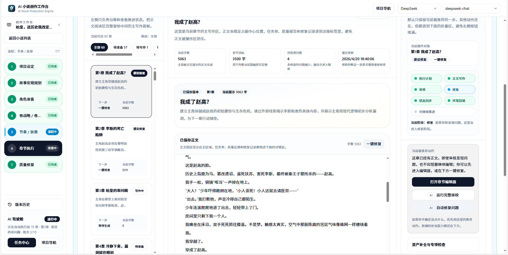 | 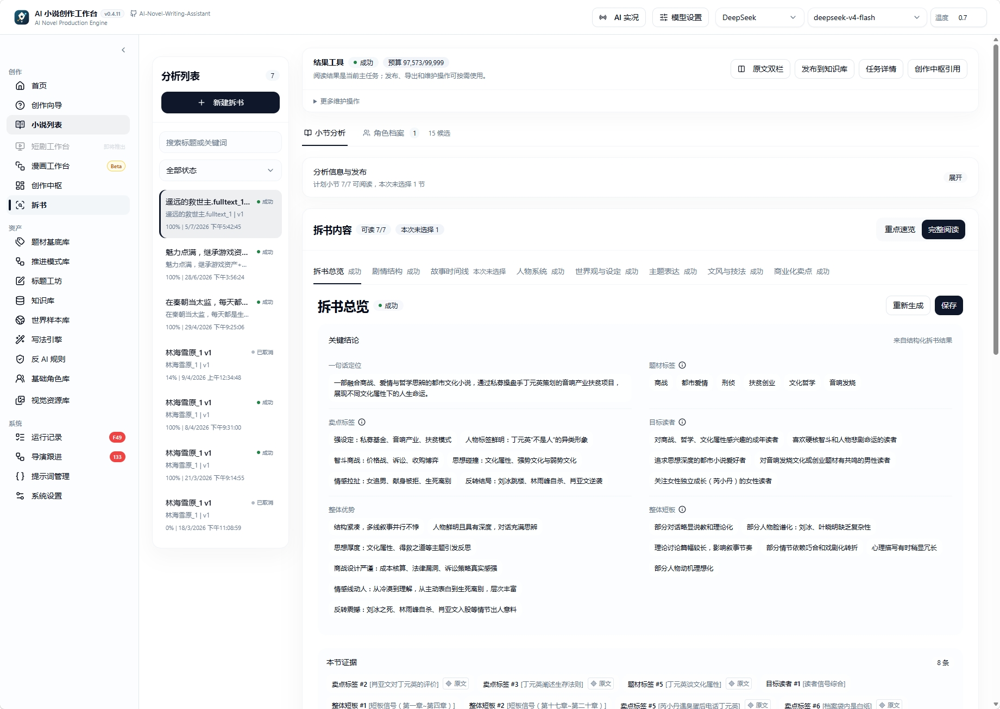 |
| Drafts, chapter tasks, and review results are organized around the same chapter. | Extract reusable writing insights from a work's structure and source-text evidence. |

<details>
<summary><strong>More: book setup and the staged V1 workspace</strong></summary>

### Choose a book direction

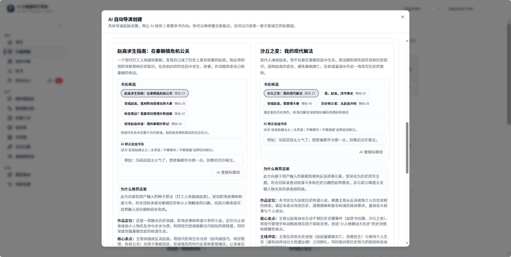

### V1 story planning and character preparation

| Story macro planning | Character preparation |
| --- | --- |
| 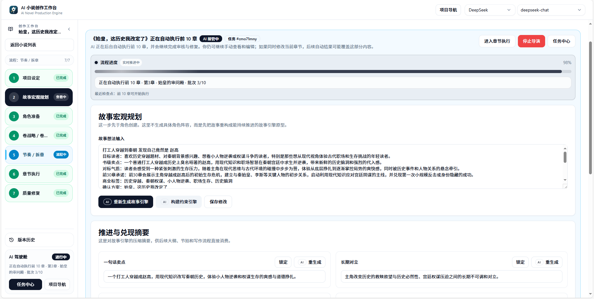 | 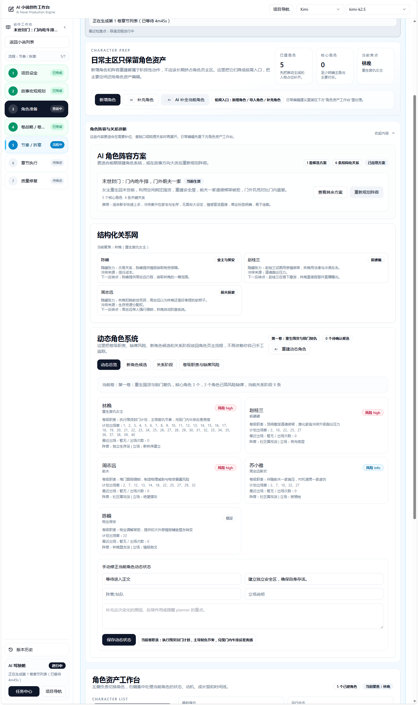 |

### V1 volume planning and chapter breakdown

| Volume strategy | Pacing and chapter planning |
| --- | --- |
| 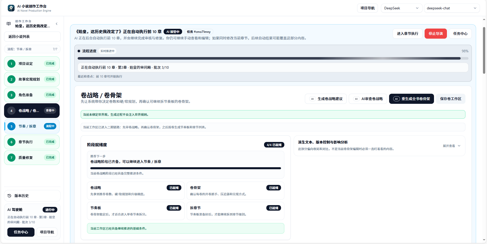 | 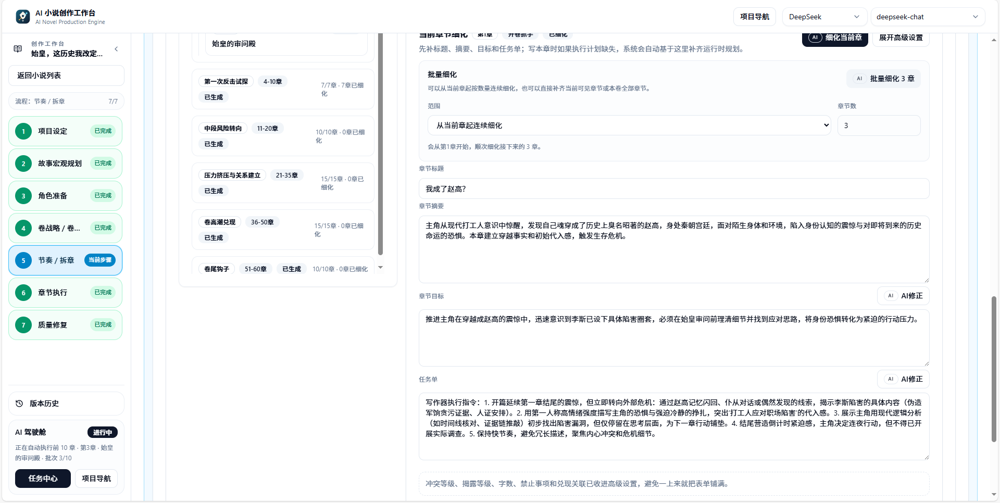 |

</details>

<details>
<summary><strong>More: world references, style tools, and model settings</strong></summary>

### World references and visualization

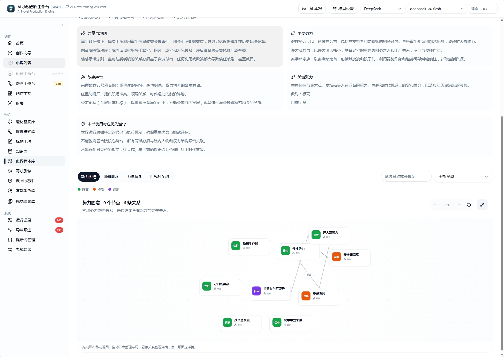

### Style Engine and anti-AI rules

| Style assets | Expression rules |
| --- | --- |
| 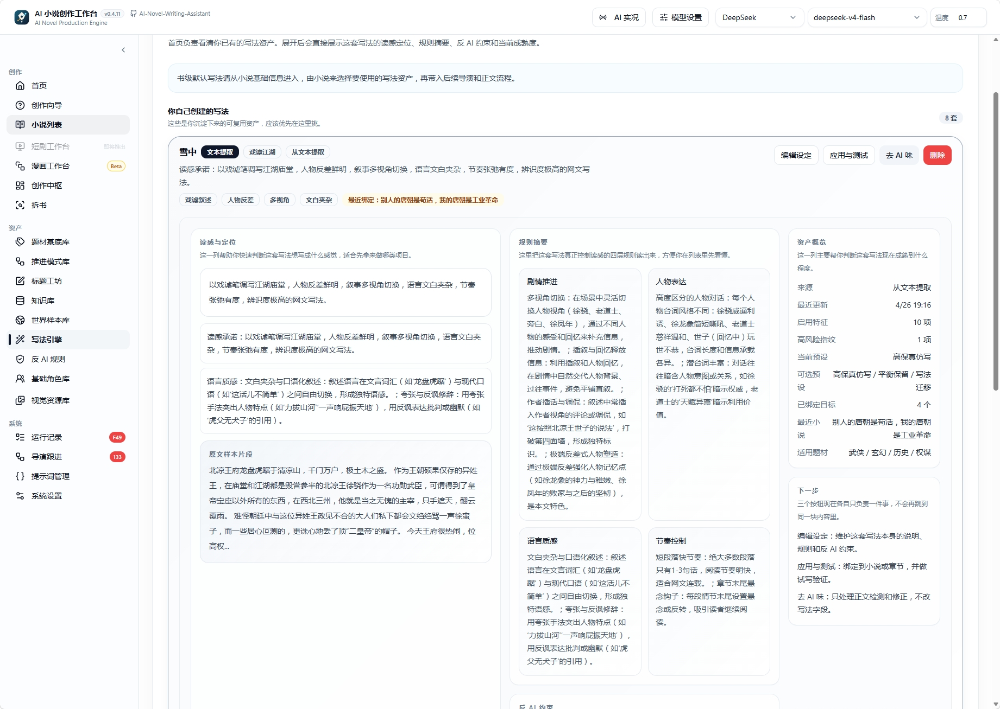 | 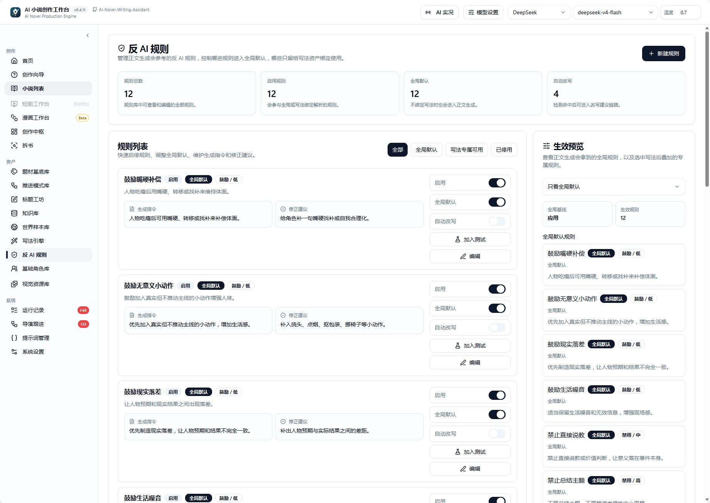 |

### Model settings

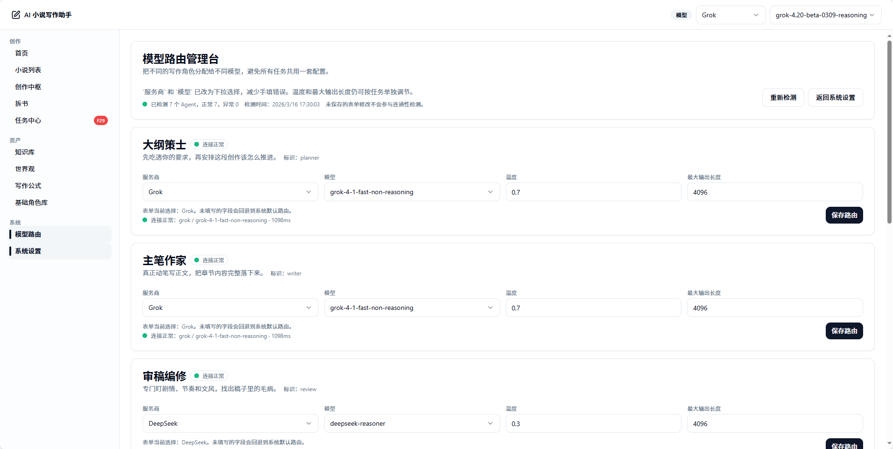

</details>

## From inspiration to chapters

This diagram shows the long-form writing workflow. Solid arrows represent the main production flow; dashed arrows represent optional references and constraints. Short stories use a separate planning, generation, and full-review process.

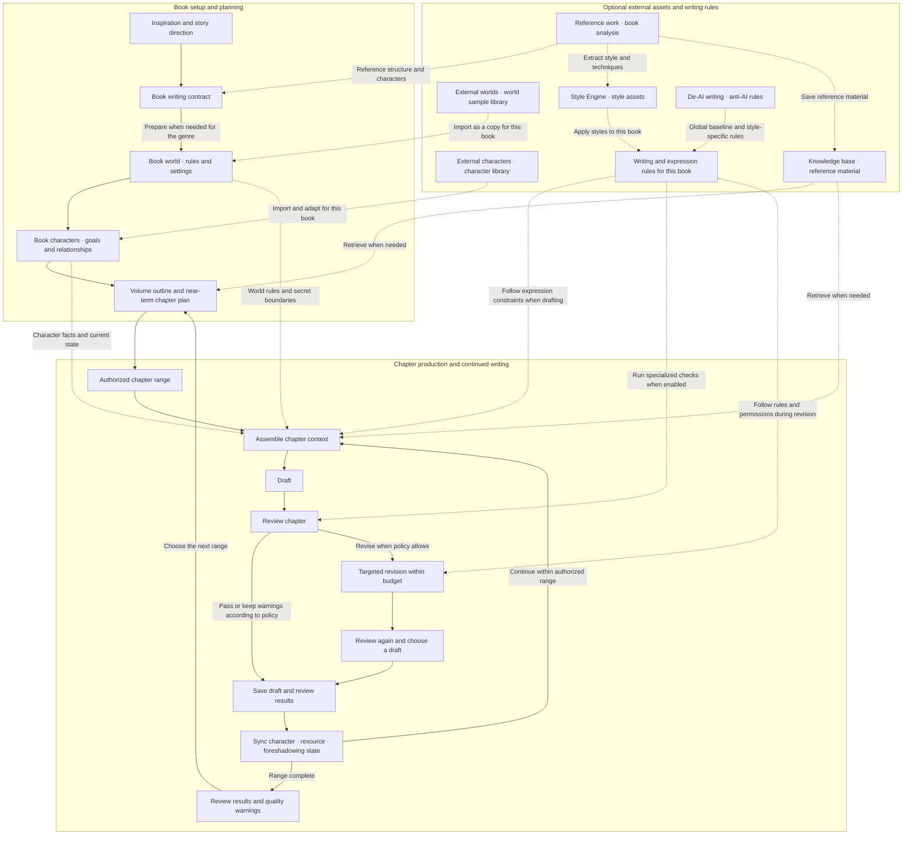

- **External worlds and characters:** Import [world samples](./docs/public/modules/world-sample-library.md) as copies for a book and [character-library](./docs/public/modules/character-library.md) assets as book characters, then adapt them to the story. Story changes stay with the book; you choose whether to sync long-term assets.
- **Style and de-AI writing:** The [Style Engine](./docs/public/modules/style-engine.md) and [anti-AI rules](./docs/public/modules/anti-ai-rules.md) provide expression constraints. Specialized checks are added to chapter review according to settings. Revisions follow the targeted-edit workflow and its permissions; rules configured as warnings remain warnings.
- **References and state updates:** Book analysis and the knowledge base provide optional references. Character, resource, and foreshadowing state synchronized after each chapter helps later chapters carry forward established events.

V1 and V2 orchestrate this workflow independently, and both can reuse saved book assets. Chapter review and revision follow the current quality policy. See [Pauses and errors](#pauses-and-errors) for recovery guidance.

<details>
<summary><strong>View production and interaction diagrams</strong></summary>


[](https://explosivecoderflome.github.io/AI-Novel-Writing-Assistant/architecture/auto-director-idea-to-novel.detailed.workflow.html)

[Open the interactive architecture diagram](https://explosivecoderflome.github.io/AI-Novel-Writing-Assistant/architecture/auto-director-idea-to-novel.detailed.workflow.html) · [Diagram source data](./docs/architecture/auto-director-idea-to-novel.detailed.workflow.json)

The interactive diagram was generated with [Archify](https://github.com/tt-a1i/archify) and shows details of the production workflow. For V2's independent runs and recovery rules, see the [Development Wiki](./docs/wiki/workflows/director-version-isolation.md).

</details>

## Documentation

| Topic | Start here |
| --- | --- |
| Download, model setup, and first launch | [Installation and setup](./docs/public/installation.md) · [System Settings](./docs/public/modules/system-settings.md) |
| First V2 project and run-mode selection | [Quick start](#quick-start) · [Versions and run modes](#director-versions-and-run-modes) |
| Short-story generation and revision | [Short-story workflow](#write-a-complete-short-story) · [Short-story workflow development notes](./docs/wiki/workflows/creation-studio-short-story.md) |
| Token caching and usage reporting | [Caching and usage optimization](#understanding-ai-usage) · [AI usage](#understanding-ai-usage) |
| V1's staged writing workflow | [First-novel walkthrough](./docs/public/playbook/first-novel-walkthrough.md) · [Auto Director pipeline](./docs/public/flow/auto-director-pipeline.md) |
| Style, characters, and reference material | [Style Engine](./docs/public/modules/style-engine.md) · [Character library](./docs/public/modules/character-library.md) · [Knowledge base](./docs/public/modules/knowledge-base.md) |
| Task errors and recovery | [Troubleshooting](./docs/public/troubleshooting.md) · [Task center](./docs/public/modules/task-center.md) · [V1 phase recovery](./docs/public/playbook/recovery-by-phase.md) |
| Architecture, module boundaries, and development | [Development Wiki](./docs/wiki/README.md) · [Documentation index](./docs/README.md) · [Agent guidelines](./AGENTS.md) |
| Release history and roadmap | [Release history](./docs/releases/release-notes.md) · [Roadmap](./TASK.md) |

You can also search the [online documentation site](https://biznovelstudio.com) for modules and usage questions.

## Run from source

### Requirements

| Component | Requirement |
| --- | --- |
| Node.js | `^20.19.0 \|\| ^22.12.0 \|\| >=24.0.0`, matching the root `package.json` |
| pnpm | `>=10.6.0`; the repository specifies `pnpm@10.6.0` |
| Text model | At least one working API configuration; it can be added after launch |
| Database | Local SQLite by default; PostgreSQL can be configured on the server |
| Knowledge retrieval | Optional Qdrant and embedding model; not required to start writing |

### Install and launch

```bash
git clone https://github.com/ExplosiveCoderflome/AI-Novel-Writing-Assistant.git
cd AI-Novel-Writing-Assistant
pnpm install
```

Copy the server configuration file using the command for your terminal:

```powershell
# Windows PowerShell
Copy-Item server/.env.example server/.env
```

```bash
# macOS / Linux
cp server/.env.example server/.env
```

In `server/.env`, check the following defaults:

```env
# V1/V2 selection is enabled by default; set to false to temporarily disable V2
DIRECTOR_NEXT_ENABLED=true

# Keep retrieval disabled until Qdrant is configured
RAG_ENABLED=false
```

Then start the app from the repository root:

```bash
pnpm dev
```

The frontend is available at `http://localhost:5173` and the server at `http://localhost:3000`. The first development launch prepares Prisma Client and the database schema, so manual database commands are usually unnecessary. If connecting to an existing database, verify the configuration and keep a backup. After launch, configure and test a model in System Settings.

Web development uses Vite's same-origin `/api` proxy by default, so local and LAN access usually do not require `client/.env`. Set `VITE_API_BASE_URL` only when deploying the frontend and backend separately or using a different server.

### Common commands

| Command | Purpose |
| --- | --- |
| `pnpm dev` | Start the shared package, server, and web client |
| `pnpm dev:desktop` | Start the desktop development environment and prepare Electron as needed |
| `pnpm dev:site` | Preview the public site and documentation |
| `pnpm build` | Build the shared package, server, and web client |
| `pnpm typecheck` | Type-check the shared package, server, client, and desktop app |
| `pnpm test` | Run the server's fast test suite |
| `pnpm test:client` | Run client tests |
| `pnpm check:docs-manifest` | Check the public documentation manifest and stage descriptions |

See the root [package.json](./package.json) for all commands. Test scope and isolation are described in [backend testing](./docs/architecture/testing.md).

<details>
<summary><strong>Advanced setup: environment variables, knowledge retrieval, and troubleshooting</strong></summary>

### Configuration files

- The server reads `server/.env`; the frontend reads `client/.env` or `client/.env.local`.
- The root `.env.example` is an overview and does not replace package-specific configuration.
- Save API keys and models in System Settings. Model routing lets you configure planning, drafting, review, and book analysis separately.
- The default SQLite connection is `file:./dev.db`. Existing data locations depend on the active runtime configuration; the desktop and source versions use different data directories.

### Run the frontend and backend separately

If the frontend needs to connect to an API on another machine, set this in `client/.env`:

```env
VITE_API_BASE_URL=http://your-server:3000/api
```

Restart the frontend after changing Vite environment variables. Server ports, bind addresses, and CORS settings are documented in [server/.env.example](./server/.env.example). Production web deployments also need access boundaries configured for their domain.

### Enable knowledge retrieval

Configure a Qdrant URL and credentials in `server/.env`:

```env
RAG_ENABLED=true
QDRANT_URL=http://127.0.0.1:6333
QDRANT_API_KEY=
```

Replace the address and credentials when using a remote instance. After startup, configure an embedding model and collection under Knowledge Base → Vector Settings, then import and index material. See the [Knowledge Base guide](./docs/public/modules/knowledge-base.md).

### Installation stalls or the desktop runtime is missing

Check the Node.js version and package-manager configuration:

```bash
node -v
pnpm -v
pnpm config get script-shell
npm config get script-shell
```

If `script-shell` is set to `cmd.exe /k`, installation scripts may stop at an interactive prompt. Remove the custom setting and reopen the terminal before reinstalling. The first desktop-development launch downloads the Electron runtime; if the network is unavailable, configure a proxy or mirror, or run `pnpm run prepare:desktop-runtime` separately.

</details>

## Technology and architecture

| Layer | Main technologies |
| --- | --- |
| Client | React 19, Vite, TypeScript, TanStack Query, Plate |
| Server | Express 5, Prisma, Zod |
| AI and tool orchestration | LangChain, LangGraph, product-level Prompt Registry |
| Desktop | Electron |
| Data and retrieval | SQLite / PostgreSQL, Qdrant |
| Repository structure | pnpm workspace |

```text
client/   Web interface, novel workspace, and Director workspace
server/   API, model calls, Director, and chapter production
shared/   Shared frontend/backend types and runtime contracts
desktop/  Electron shell, desktop runtime, and packaging
site/     Public introduction and documentation navigation
docs/     User guides, Development Wiki, design notes, and release history
scripts/  Startup, verification, and engineering scripts
images/   Feature previews and documentation screenshots
```

The V2 core is in `server/src/modules/director/`, with capabilities connected through the application layer. V1 retains its own orchestration modules. Both versions use saved novel assets and shared chapter capabilities, while tasks, recovery, and version ownership remain independent. See [version isolation](./docs/wiki/workflows/director-version-isolation.md), [module boundaries](./docs/wiki/architecture/module-boundaries.md), and the [chapter production workflow](./docs/wiki/workflows/chapter-production-chain.md).

## Contributing

Report problems through [Issues](https://github.com/ExplosiveCoderflome/AI-Novel-Writing-Assistant/issues) or submit a Pull Request. Areas of interest include continuous generation and recovery, the first-book experience, long-form consistency, and traceable model usage. Include the app version, selected Director and mode, steps to reproduce, and relevant logs when reporting an issue.

Before contributing, read [CONTRIBUTING.md](./CONTRIBUTING.md) and [CLA.md](./CLA.md), and identify third-party code or assets and their licenses. Thanks to everyone who tests, shares suggestions, and contributes fixes, including [@ystyleb](https://github.com/ystyleb).

### Community

<p align="center">
  <a href="https://linux.do/"></a>
</p>

<p align="center">
  <a href="https://linux.do/"><strong>LINUX DO</strong></a>
  ·
  <a href="https://linux.do/t/topic/2738271">Project discussion</a>
</p>

### Contact and support

<details>
<summary><strong>Expand: QQ group and project support</strong></summary>

Join the QQ group to discuss writing, Auto Director, or project development. If the studio is useful to you, you can also support its continued development and maintenance.

| QQ group | Support the project (Alipay) |
| --- | --- |
|  |  |

</details>

### Write in Codex: Ani Book Skill

If you prefer to advance a long-form project directly in Codex's local file workspace, see the companion [Ani Book Skill](https://github.com/ExplosiveCoderflome/ani-book-skill). It uses staged artifacts for planning, writing, and review. This repository provides a visual workspace; choose either entry point to suit your workflow.

## License

This project uses a dual-licensing model:

- By default, it is licensed under the GNU Affero General Public License v3.0 (AGPLv3); see [LICENSE](./LICENSE). Attribution and additional notices are in [NOTICE](./NOTICE).
- Commercial service use: using this project or a modified version as a backend service for third parties, including SaaS or hosted services, requires a commercial license from the author.
- New contributions are submitted under [CLA.md](./CLA.md). They may be distributed under AGPL-3.0-only or included in a separate commercial license offered by the maintainers.

[Contribution and licensing details](./CONTRIBUTING.md)
